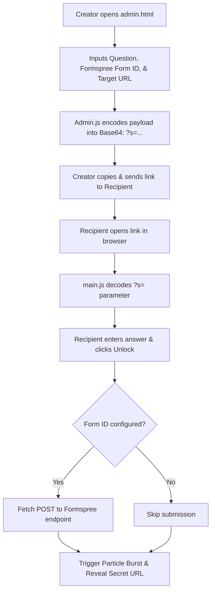

# Surprise Portfolio 🎁

A client-side interactive web application designed to deliver personalized surprise links, secret portfolio reveals, or custom riddles with a cyberpunk glassmorphism aesthetic.

Recipients answer a custom question to unlock their secret destination. If configured, responses are sent to the creator via Formspree, followed by celebration animations and access to the target URL.

---

## Features

- **Interactive Unlock Gate**: Displays a customizable riddle or question inside a glassmorphism card.
- **Formspree Notification (Optional)**: Forwards answers directly to a creator's email via Formspree API (`https://formspree.io/f/{id}`) without exposing private email addresses in the URL.
- **Client-Side Admin Dashboard (`admin.html`)**:
  - Configure question, optional Formspree Form ID, and destination link.
  - Automatically encodes the configuration into a portable Base64 URL parameter (`?s=...`), eliminating the need for a database or backend server.
  - One-click "Copy" link to clipboard.
  - LocalStorage draft persistence for subsequent visits.
- **Cyberpunk Visuals & Animations**:
  - Pure CSS matrix digital grid background and animated binary scanline.
  - Interactive glitch effects and dynamic JavaScript falling character particles.
  - Shaking micro-animation on invalid empty inputs.
  - Celebration confetti burst upon surprise unlock.
- **Zero Build Dependencies**: Runs directly in any modern browser without npm packages, bundlers, or compilation steps.
- **Vercel-Ready**: Includes `vercel.json` configured for clean URLs (`/admin` and `/`).

---

## Tech Stack

- **Markup**: HTML5 (Semantic, SEO metadata, Open Graph tags)
- **Styling**: Vanilla CSS3 (Custom properties, Flexbox, glassmorphism `backdrop-filter`, CSS keyframe animations)
- **Scripting**: Vanilla JavaScript (ES6+, Fetch API, LocalStorage, Base64 encoding/decoding via `btoa`/`atob`)
- **Typography**: [Google Fonts](https://fonts.google.com/) ([Poppins](https://fonts.google.com/specimen/Poppins) & [JetBrains Mono](https://fonts.google.com/specimen/JetBrains+Mono))
- **Integration**: [Formspree](https://formspree.io/) for submission handling
- **Configuration**: `vercel.json` for deployment routing

---

## Project Structure

```text
Surprise-Portfolio/
├── .gitignore          # Git exclusion rules for OS, editors, and local artifacts
├── LICENSE             # MIT License
├── README.md           # Project documentation
├── admin.html          # Creator dashboard to build custom surprise links
├── admin.js            # Admin dashboard logic, link generator & LocalStorage draft sync
├── favicon.png         # Site favicon (neon red skull icon)
├── index.html          # Recipient unlock page & interactive surprise gate
├── main.js             # Unlock logic, URL payload decoding, Formspree submission & particles
├── style.css           # Cyberpunk theme, layout, glassmorphism, and responsive rules
└── vercel.json         # Vercel deployment routing (cleanUrls)
```

---

## Getting Started

### Prerequisites

A modern web browser (e.g., Google Chrome, Mozilla Firefox, Microsoft Edge, Safari). No runtime or package manager is required.

### Local Development

1. **Clone the repository:**
   ```bash
   git clone https://github.com/nfsprogramming/Surprise-Portfolio.git
   cd Surprise-Portfolio
   ```

2. **Run locally using any static web server:**
   - **Python 3:**
     ```bash
     python -m http.server 3000
     ```
   - **Node.js (`npx serve`):**
     ```bash
     npx serve .
     ```
   - **VS Code Live Server:** Right-click `index.html` and select **Open with Live Server**.

3. **Open in browser:**
   - Recipient Gateway: `http://localhost:3000/index.html`
   - Creator Dashboard: `http://localhost:3000/admin.html`

---

## How It Works



### URL Encoding Details

The Admin Dashboard generates URLs with a base64 query parameter `?s=`:
```json
{
  "q": "Your custom question",
  "e": "optional_formspree_id",
  "l": "https://example.com/secret-portfolio"
}
```
When opened, `main.js` reads `window.location.search`, decodes the payload, and dynamically initializes the gateway.

---

## Deployment

### Vercel (Recommended)

1. Import the repository into [Vercel](https://vercel.com/).
2. Vercel automatically detects the static project and applies `vercel.json` for clean URL routing.
3. Access your deployment at your assigned Vercel URL.

### GitHub Pages

1. Navigate to repository **Settings** > **Pages**.
2. Under **Build and deployment**, select `Deploy from a branch`.
3. Choose branch `main` and folder `/ (root)`, then click **Save**.

---

## Testing & Validation

To validate HTML and CSS syntax:
- **HTML validation**: Using [W3C Nu HTML Checker](https://validator.w3.org/nu/).
- **CSS validation**: Using [W3C CSS Validation Service](https://jigsaw.w3.org/css-validator/).
- **Local sanity check**: Ensure JavaScript console produces 0 uncaught errors on both `index.html` and `admin.html`.

---

## Limitations

- **Client-Side Obfuscation**: The secret URL is encoded in Base64 within the query parameter. Any technical user can decode the payload using browser DevTools or standard base64 decoding utilities. It is designed for casual interactive surprises and portfolio reveals, not cryptographic security.
- **Static Hosting**: Form submissions depend on the third-party Formspree service.

---

## Contributing

Contributions, bug reports, and suggestions are welcome.
1. Fork the repository.
2. Create your feature branch (`git checkout -b feature/improvement`).
3. Commit your changes (`git commit -m "Add feature"`).
4. Push to the branch (`git push origin feature/improvement`).
5. Open a Pull Request.

---

## License

This project is licensed under the MIT License - see the [LICENSE](LICENSE) file for details.
